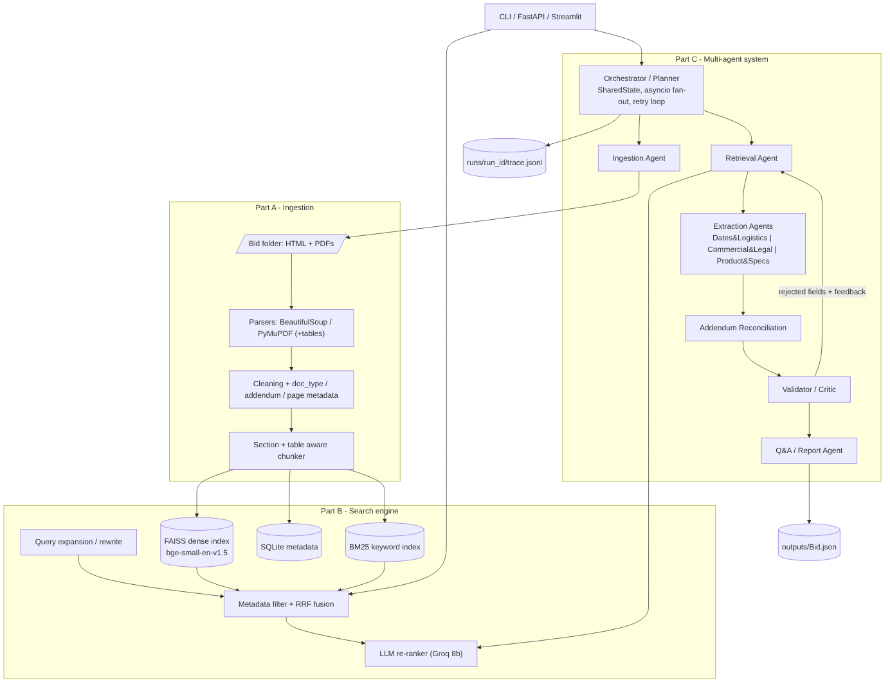

# RFP Intelligence Platform

Hybrid RAG search engine + multi-agent system that reads bid / RFP folders (BidNet HTML pages, RFP PDFs,
addendums, spec sheets, affidavits), makes them searchable with citations, extracts a 20-field structured
record per bid (with sources + confidence, addendum-aware) and answers free-form questions.

LLM: any OpenAI-compatible provider, chosen with `LLM_PROVIDER` (**Gemini** or **NVIDIA NIM** recommended for the free tier; Groq, OpenAI,
OpenRouter and Ollama also work). Embeddings: local `BAAI/bge-small-en-v1.5` via fastembed (no API key). Vector store: FAISS.
Keyword search: BM25. Agents: custom asyncio orchestration with Pydantic messages.



(Mermaid source and the step-by-step message flow: [docs/architecture.md](docs/architecture.md))

---

## 1. Setup

```bash
# Python 3.10+ (tested on 3.11 and 3.13)
git clone <repo> && cd rfp-intel
python -m venv .venv && source .venv/bin/activate      # Windows: .venv\Scripts\activate
pip install -r requirements.txt

cp .env.example .env
# edit .env: pick LLM_PROVIDER and paste that provider's key, e.g.
#   LLM_PROVIDER=gemini   GEMINI_API_KEY=...   (free key: https://aistudio.google.com/apikey)
#   LLM_PROVIDER=groq     GROQ_API_KEY=...     (free key: https://console.groq.com/keys, only 8k tokens/min)
python main.py models        # lists the model ids your key can use; set LLM_MODEL / LLM_SMALL_MODEL if needed
```

Provider defaults (override with `LLM_MODEL` / `LLM_SMALL_MODEL` / `LLM_BASE_URL` in `.env`):

| LLM_PROVIDER | main model | small model (rerank / rewrite) | key variable |
|---|---|---|---|
| gemini | gemini-3-flash-preview | gemini-3.1-flash-lite | GEMINI_API_KEY |
| groq | openai/gpt-oss-120b | openai/gpt-oss-20b | GROQ_API_KEY |
| nvidia | meta/llama-3.3-70b-instruct | meta/llama-3.1-8b-instruct | NVIDIA_API_KEY |
| chutes | deepseek-ai/DeepSeek-V3.2 | google/gemma-4-31b-it | CHUTES_API_KEY |
| openai | gpt-4o-mini | gpt-4o-mini | OPENAI_API_KEY |
| openrouter | meta-llama/llama-3.3-70b-instruct | meta-llama/llama-3.1-8b-instruct | OPENROUTER_API_KEY |
| ollama | llama3.1 (local) | llama3.1 | none |

The first run downloads the bge-small embedding model (~130 MB) once into the fastembed cache. Everything else
runs locally. The bid folders are in `data/Bid1` and `data/Bid2`; any new folder with the same shape works
without code changes.

## 2. Run

| What | Command |
|---|---|
| Index bid folders (incremental) | `python main.py index ./data/Bid1 ./data/Bid2` |
| **Extraction mode** (one command, indexes if needed) | `python main.py --bid ./data/Bid1` |
| Extraction of an already indexed bid | `python main.py extract --bid-id Bid2` |
| **Question-answering mode** | `python main.py ask "What is the submission deadline for Bid1 after all addendums?"` |
| Search engine alone (CLI) | `python main.py search "bid bond" --bid-id Bid1 --top-k 5 --mode hybrid` |
| Search with filters | `python main.py search "new due date" --bid-id Bid1 --doc-type addendum --no-rerank` |
| Bid comparison (bonus) | `python main.py compare Bid1 Bid2` |
| Retrieval evaluation | `python main.py eval` (writes `eval/results.md`) |
| Sample Q&A log | `python main.py qa-log` (writes `outputs/qa_log.md`) |
| REST API | `python main.py serve` then open http://localhost:8000/docs |
| Web UI (bonus) | `python main.py ui` then open http://localhost:8501 |
| List Groq models your key can use | `python main.py models` |
| Unit tests | `pytest -q` |
| Everything at once | `./run_all.sh` |
| Docker | `docker compose up` (API on :8000, UI on :8501) |

Unseen bid: `python main.py --bid /path/to/Bid3` - the folder name becomes the `bid_id`.

Recommended order on a fresh clone: `index` -> `--bid` for each bid -> `qa-log` -> `eval` -> `compare` -> `ui`.
The UI presents the index, the extraction records, the Q&A log, the comparison, the evaluation and the agent traces.

### REST API

```
POST /index     {"folder": "./data/Bid3"}
GET  /search?q=bid%20bond&bid_id=Bid1&doc_type=rfp,addendum&top_k=5&mode=hybrid&rerank=true
POST /ask       {"question": "Which affidavits are required for the Dell laptop bid?"}
POST /extract   {"folder": "./data/Bid1"}      or {"bid_id": "Bid1"}
POST /compare   {"bid_ids": ["Bid1", "Bid2"]}
GET  /bids  GET /stats  GET /health
```

### Outputs

```
outputs/Bid1.json, outputs/Bid2.json     structured records (value, sources, confidence, notes, addendum_changes, validation)
outputs/<bid>_summary.md                 human readable report
outputs/qa_log.md                        sample questions with cited answers
outputs/comparison.md                    side-by-side comparison
eval/results.md / results.json           Recall@k, MRR, nDCG per configuration
runs/<run_id>/trace.jsonl + summary.json one record per agent step (input, tool calls, output, tokens, latency)
                                         (the two committed runs are the example traces for Bid1 and Bid2)
```

---

## 3. Project structure

```
main.py                     CLI (index | extract | ask | search | compare | eval | qa-log | serve | ui)
rfp_intel/
  config.py                 all settings from env / .env (no secrets or model names in code)
  models.py                 Pydantic models: chunks, search results, field values, agent messages, SharedState
  ingestion/  html_parser.py pdf_parser.py cleaning.py doc_types.py chunker.py pipeline.py
  search/     embeddings.py store.py (FAISS + SQLite + BM25) query.py reranker.py engine.py
  llm/        client.py (Groq, retries, token accounting) tracing.py (jsonl traces)
  agents/     fields.py orchestrator.py ingestion_agent.py retrieval_agent.py extraction_agent.py
              reconciliation_agent.py validator_agent.py qa_agent.py base.py
  api/app.py                FastAPI
ui/streamlit_app.py         Streamlit UI: hybrid search, extraction records, Q&A, bid comparison, evaluation, agent traces
eval/                       eval_set.json (28 questions), run_eval.py, sample_questions.json, qa_log.py
tests/                      parsing, search and agent-pipeline tests (fake LLM, no network)
docs/                       architecture diagram (png + mermaid) and message flow
Dockerfile, docker-compose.yml, .github/workflows/ci.yml, run_all.sh
```

---

## 4. Design decisions

### Part A - Ingestion & parsing
* **HTML (BidNet pages)**: BeautifulSoup. Portal pages are mostly *label -> value* widgets; we collect
  `.mets-field-label/.mets-field-body` pairs (plus generic `dt/dd` and 2-column `tr` fallbacks for other portals)
  and render them as a markdown "Bid Information" table, keep the contact block and description, and drop
  nav/scripts/cookie banners. Exact values (solicitation number, closing date, contact) therefore sit in one
  compact, keyword-friendly chunk.
* **PDF**: PyMuPDF with `sort=True` reading order (important for form-style PDFs like the PORFP) and
  `page.find_tables()` for tables (spec/SKU table, price schedule, POC tables), rendered as markdown with empty
  layout columns removed. Each page is kept separate so every chunk has a page number.
* **Cleaning**: running headers/footers are detected statistically (lines that repeat on >= 3 pages in the top/
  bottom 3 lines, digits masked), `Page x of y` markers dropped, hyphenated line breaks joined, wrapped lines
  re-joined, whitespace normalised.
* **Metadata**: `bid_id` (folder name), `file_name`, `doc_type` (`bid_page | rfp | addendum | specs | affidavit |
  other`, from file name + first-page content), `addendum_number` (regex on name / first page), `page_number`,
  `document_date` (first date found on page 1). Empty / scanned pages are logged as warnings and skipped;
  unreadable files produce an empty document with a warning instead of crashing. OCR via PyMuPDF/Tesseract is
  available with `OCR_ENABLED=true` when tesseract is installed.

### Part B - Search engine
* **Chunking** (`ingestion/chunker.py`): section-aware. Headings are detected (ALL-CAPS multi-word lines,
  numbered "1.2 Terms", "Section 4 - Scope of Work"), small form-label sections are merged with their neighbours,
  and each section is windowed at **1800 characters (~400-450 tokens) with 250 characters overlap**, cutting on
  paragraph/sentence boundaries. Tables are emitted as **whole chunks** (long tables are split by rows with the
  header repeated) so a SKU never loses its description. Every chunk text starts with a provenance header
  (`[Bid2 | PORFP_-_Dell_Laptop_Final.pdf | rfp] p.3 | Section 4 - Scope of Work`) that also helps the embedder and
  BM25. Why 1800/250: RFP clauses (a due-date block, one device tier spec, one addendum Q&A) are typically
  300-1500 characters; 1800 keeps a whole clause in one chunk with its heading while staying precise enough
  for page-level citations and cheap enough to show 6-10 passages to the extractor. Both are env-configurable.
* **Embeddings**: `BAAI/bge-small-en-v1.5` through fastembed (ONNX, CPU, 384-d, strong on short retrieval
  passages, no API cost). A dependency-free `hash` backend (hashed word/char-trigram features) is used by the
  tests and as an automatic fallback if the model cannot be downloaded, so the system never hard-fails offline.
* **Store**: FAISS `IndexIDMap2(IndexFlatIP)` (exact cosine) + SQLite for chunk text/metadata + an in-memory
  `BM25Okapi`. **Incremental indexing**: `add_bid()` removes only that bid's ids (`remove_ids`) and appends the new
  vectors - indexing Bid3 never touches Bid1/Bid2. A manifest guards against mixing embedding backends.
* **Hybrid retrieval**: dense + BM25 candidates (pool of 30 each) fused with **Reciprocal Rank Fusion** (k=60).
  The BM25 tokenizer keeps identifiers intact *and* adds their parts (`JA-207652 -> ja-207652, ja, 207652`;
  `400-BRFT -> 400-brft, 400, brft`), which is what makes bid/part/model numbers reliable.
* **Metadata filtering**: `bid_id`, `doc_type` (list), `addendum_number`, `file_name` substring - applied as a
  pre-filter (FAISS `IDSelectorBatch`, BM25 allowed-id set), e.g. "only Bid2 specs".
* **Re-ranking**: LLM listwise re-ranker on the top 20 fused candidates (`openai/gpt-oss-20b`, JSON scores 0-10);
  final score = 0.7 x LLM + 0.3 x fused rank so a noisy judge cannot erase a strong hybrid signal. Falls back to the
  hybrid order on any error. (A cross-encoder was avoided to keep the install torch-free.)
* **Query understanding**: deterministic synonym expansion for RFP vocabulary (`deadline -> due date, closing
  date, proposal due...`, `bid bond -> bid security, surety...`) feeds BM25; optional LLM paraphrases
  (`QUERY_REWRITE_LLM=true`, always on in Q&A mode) are run as extra queries and fused.
* **Citations**: every result carries `file_name`, `page_number`, `doc_type`, `addendum_number`, `chunk_id`,
  the chunk text and which retrievers surfaced it.

### Part C - Multi-agent system
* **Framework**: hand-rolled `asyncio` orchestration with Pydantic models for every message
  (`SearchResult`, `FieldValue`, `AddendumChange`, `ValidationReport`, `SharedState`...). Reasons: the control
  flow here is a fixed DAG with one feedback loop, which is ~150 lines of plain Python; it keeps the dependency
  footprint small (no LangGraph/CrewAI version churn), every step is transparent and unit-testable with a fake
  LLM, and Groq's rate limits are easier to respect with an explicit semaphore than inside a framework's
  executor. Swapping to LangGraph would map 1:1 (agents = nodes, `SharedState` = graph state).
* **Agents** (one responsibility each): Orchestrator/Planner, Ingestion, Retrieval, three Extraction
  specialists (Dates & Logistics, Commercial & Legal, Product & Specs) + Summary, Addendum Reconciliation,
  Validator/Critic, Q&A/Report (also does bid comparison). Agents only see passages returned by the search tool,
  never whole documents.
* **Shared state**: `SharedState` holds plan, per-field evidence, draft fields, addendum change log, validation
  report, retry counters, errors and the final output.
* **Parallelism**: all 19 content fields are extracted concurrently (`AGENT_CONCURRENCY`, default 4) with one
  small LLM call per field, which keeps every prompt well under Groq's per-request limits.
* **Feedback loop**: Validator -> failed fields (with the failure message as feedback and as an extra retrieval
  query) -> Retrieval + Extraction again, at most `MAX_FIELD_RETRIES` (2). Fields still failing are set to
  `null` with the reason - an unsupported value is never emitted.
* **Guardrails**: extraction prompts forbid outside knowledge; `null + "Not found in documents"` is the required
  answer when evidence is missing; the validator enforces >= 1 citation per value, that the cited file/page exist in
  the bid, that each quote really occurs in the cited chunk (normalised, 80 % token overlap), ISO date format for
  Due Date, and an LLM critic checks that quotes support the value.
* **Addendum reconciliation**: addendum passages are retrieved per addendum-sensitive field, the LLM reports
  changes with evidence ids and the *highest* addendum wins; changed fields get the addendum as first source and a
  note `Changed by Addendum N (original value: ...)`; non-field clarifications are logged as `field: "other"`.
* **Error handling**: LLM calls retry with back-off (timeouts, 429, 5xx), bad JSON is parsed leniently then
  reported as an extraction error for that field only, empty retrieval yields a `Not found` field, one failing field
  never aborts the run.
* **Observability**: `runs/<run_id>/trace.jsonl` - one line per agent step with input, tool calls (search
  queries, filters, hit counts, latency), output, tokens and latency; `summary.json` has total LLM usage.

### Prompts
System prompts live next to the agents (`extraction_agent.py`, `reconciliation_agent.py`, `validator_agent.py`,
`qa_agent.py`, `search/reranker.py`, `search/query.py`). All use Groq JSON mode and `temperature=0`.

---

## 5. Retrieval evaluation

`eval/eval_set.json` holds **28 question -> expected passage** pairs (14 Bid1, 12 Bid2, 2 cross-bid). A result is a
hit when it comes from an expected file + page and contains the expected snippet. `python main.py eval` compares
`vector`, `keyword`, `hybrid` and `hybrid_rerank` and writes `eval/results.md`.

Results with the default setup (`BAAI/bge-small-en-v1.5` embeddings, Gemini `gemma-4-26b-a4b-it` as re-ranker):

| Config | Recall@1 | Recall@3 | Recall@5 | MRR | nDCG@3 | nDCG@5 | avg latency (ms) |
|---|---|---|---|---|---|---|---|
| vector (bge-small, FAISS) | 0.714 | 0.929 | 0.964 | 0.817 | 0.837 | 0.843 | 15 |
| keyword (BM25 + synonym expansion) | 0.714 | 0.964 | 1.000 | 0.836 | 0.860 | 0.866 | 1 |
| hybrid (RRF) | 0.786 | 0.964 | 0.964 | 0.869 | 0.885 | 0.879 | 13 |
| **hybrid + LLM re-ranker** | **0.821** | **1.000** | **1.000** | **0.911** | **0.925** | **0.913** | 15 972 |

Only one question (`b2-09`, the agency POC phone number, which lives in a PDF table split across cells) is missed
by the dense and plain hybrid configurations; BM25 finds it because the identifier tokenizer keeps the phone digits
intact, and the re-ranker recovers it from the fused candidate pool. Take-aways: fusion lifts Recall@1 by 7 points
over the best single retriever, and the re-ranker adds another 3.5 points of Recall@1 and 4 points of MRR, reaching
Recall@3 = 1.0, at the cost of one extra LLM call per query. The offline `hash` embedder used by CI scores
Recall@5 0.71 (vector) / 0.96 (hybrid), which is why hybrid is the default even without a good embedding model.
`eval/results.md` and `eval/results.json` hold the latest run.

---|---|---|---|---|---|---|---|
| vector (hash fallback) | 0.536 | 0.643 | 0.714 | 0.595 | 0.588 | 0.618 | 0.6 |
| keyword (BM25 + expansion) | 0.714 | 0.964 | 1.000 | 0.836 | 0.860 | 0.866 | 1.8 |
| hybrid (RRF) | 0.714 | 0.893 | 0.964 | 0.814 | 0.819 | 0.844 | 2.4 |

Run `python main.py eval` after setup to regenerate the table with the real `bge-small-en-v1.5` embeddings and
the `hybrid_rerank` row (needs `GROQ_API_KEY`); the numbers above are the floor, not the ceiling - the hash
backend is only there so the pipeline and tests run offline. Keyword search is strong on this set because many
questions contain identifiers or RFP terms that the synonym expansion maps directly; dense retrieval adds
recall on paraphrased questions (`x-02`-style) and the re-ranker fixes ordering inside the fused list.

---

## 6. Tests

`pytest -q` (23 tests, no network):
* parsing: doc-type/addendum/date detection, header-footer removal, de-hyphenation, heading detection,
  section merge + overlap windows, chunk metadata + table chunks, HTML field extraction, multi-page/empty-page
  PDFs, unreadable files, real Bid2 folder.
* search: identifier-aware tokenizer, synonym expansion, exact-id keyword hits, metadata filters, RRF math,
  hybrid fusion + citations, incremental add/remove/persistence, retrieval quality on the real bids.
* agents: full extraction run with a fake LLM (addendum override applied, hallucinated bond value rejected by the
  quote check and retried, nulled with reason, trace written), Q&A bid detection + citations.

---

## 7. Assumptions and known limitations

* `bid_id` = folder name; all files in a folder belong to one bid. Only `.pdf` and `.html/.htm` are indexed.
* Doc-type detection is heuristic (file name + first page). Unknown types fall back to `other` and are still
  indexed and searchable.
* The LLM re-ranker and query rewriting need Groq; without a key the engine still works (hybrid order).
* Providers retire models from time to time (Groq shut down the Llama 3.x models on 16 Aug 2026, Google the
  Gemini 2.5 family on 16 Oct 2026). If you get `model_not_found`, run `python main.py models` and set
  `LLM_MODEL` / `LLM_SMALL_MODEL` in `.env`.
* Rate limits: an extraction run makes ~45 LLM calls (19 fields + reranking + reconciliation + validator +
  summary + retries). The client waits for the provider's "retry after" hint on 429s. Groq's free tier
  (8k tokens/min) works but a run takes ~10-15 minutes with `AGENT_CONCURRENCY=2`; Gemini's free tier runs
  it in 1-2 minutes.
* Scanned PDFs need `OCR_ENABLED=true` and a local Tesseract install; none of the provided files are scanned
  (pages 55-59 of the Dallas ISD RFP are empty/graphic pages and are logged as such).
* Dense retrieval uses exact search (IndexFlat); for > ~1M chunks switch to an IVF/HNSW index.
* The evaluation set was written by hand from the two provided bids; expected pages reflect the PDF page
  numbering used in citations.