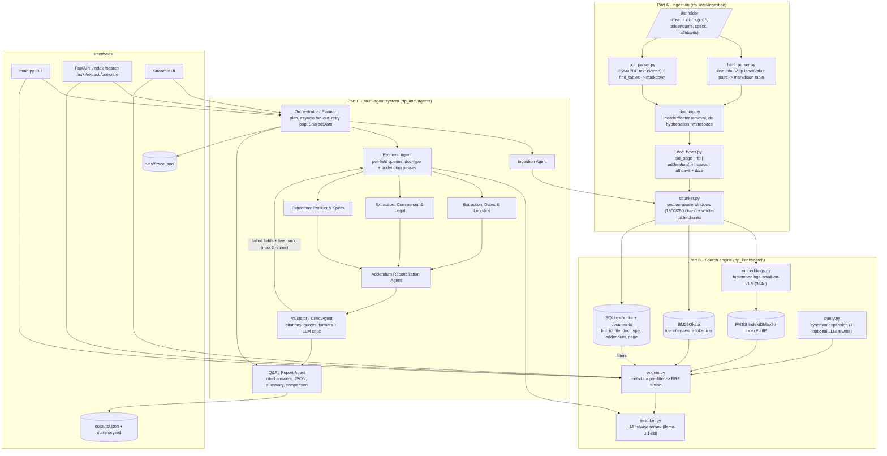

# Architecture

## Message flow of one extraction run

1. **Orchestrator** writes an `ExecutionPlan` into `SharedState` and calls the **Ingestion Agent** (no-op if the bid is already indexed).
2. For the 19 content fields (grouped into 3 specialists) it launches `asyncio` tasks (bounded by `AGENT_CONCURRENCY`). Each task:
   - **Retrieval Agent** -> `SearchEngine.search()` three times: unfiltered hybrid+rerank, filtered to the field's preferred doc types, and (for addendum-sensitive fields) filtered to `doc_type=addendum`; results are merged and de-duplicated.
   - **Extraction Agent** -> one Groq call with the `[E#]` evidence passages, returns `{value, evidence_ids, quotes, confidence, notes}` (JSON mode) -> converted to a `FieldValue` with `FieldSource` citations.
3. **Addendum Reconciliation Agent** retrieves addendum passages for all addendum-sensitive fields, asks the LLM which fields change, applies the highest-numbered addendum and records `AddendumChange` entries.
4. **Validator Agent** runs deterministic checks (citation exists in bid, quote occurs in cited chunk, date format, null-with-reason) and one LLM critic call; failed fields go back to step 2 with the validator message as feedback (max `MAX_FIELD_RETRIES`). Fields still failing are nulled with a reason, never shipped unsupported.
5. The **Summary** specialist writes `Bid Summary` with the other fields as context; the **Q&A / Report Agent** renders `outputs/<bid>.json` and `<bid>_summary.md`.
6. Every step is appended to `runs/<run_id>/trace.jsonl` (input, tool calls, output, tokens, latency, status).
